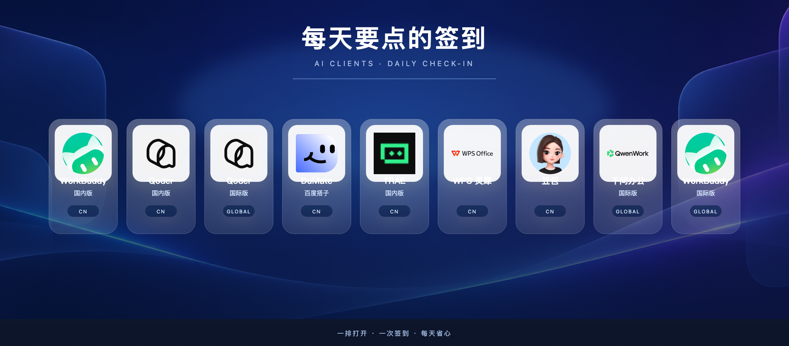
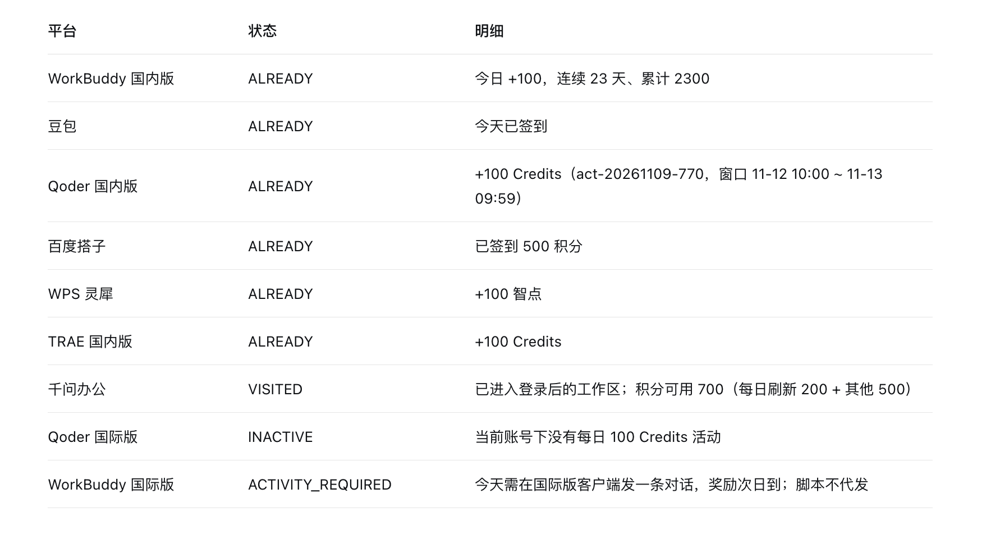

<div align="center">

# agent-auto-signin

**把每天挨个打开办公 Agent 点签到领 Token，变成一个自动任务。**

[](https://github.com/Hiwoniu/agent-auto-signin/stargazers) [](LICENSE) [](#关注向明)

[快速开始](#快速开始) · [支持的平台](#支持的平台) · [交给 Agent 部署](#交给-agent从拿到代码到部署) · [配套文章](#配套文章) · [关注向明](#关注向明)

</div>

> 📮 配套教程和后续更新发在公众号「向明」，微信搜一搜「向明」即可关注。

WorkBuddy、Qoder、豆包、TRAE、WPS 灵犀、百度搭子……每家都在送免费 Token，叫法不一样（积分、Credits、智点），规矩都一样：每天得自己去点一下。



装好之后，每天北京时间 09:30 起，它用你本机已有的登录去各家把当天的领了，不用打开这些软件，也不用守在电脑前。下面是 2026 年 11 月 12 日在 Mac 上用作者自己账号实跑的结果：



## 它帮你省了什么

| 繁琐的事 | 以前 | 现在 | 省下的时间 |
| --- | --- | --- | --- |
| 每天领各家办公 Agent 的免费 Token | 八九个软件，一个个打开、找入口、点签到；一忙就忘，Qoder 的 Credits 30 天失效，WorkBuddy 连续签到断一天重新算 | 每天 09:30 起自动领，每家单独报一个结果 | 每天那一轮手动签到，不用再做 |

按 11 月 12 日这次实跑，WorkBuddy 国内版、Qoder 国内版、百度搭子、TRAE 国内版、WPS 灵犀这五家加起来一天是 900；千问办公每天还会刷新 200 积分。各家单位不一样，不能互换，也不能拿来比大小。

活动会变。百度搭子和千问办公写明了是限时活动，Qoder 国际版的每日活动在作者账号上 11 月 12 日已经没有了。以客户端里看到的为准。

## 快速开始

安装不用自己敲命令，交给能操作电脑的 Agent 就行。

**用 WorkBuddy（跑完会直接把结果告诉你）：** 左侧点「定时任务」，右上角点「新建 → 从对话新建」，发这句话：

```text
帮我创建一个定时任务：先读取这个 README，完成部署，https://github.com/Hiwoniu/agent-auto-signin 设置定时任务
```

**用别的 Agent：** 把仓库地址和下面这段话一起发给它：

```text
请按 README 的「交给 Agent」步骤，先识别本机是 macOS、Windows 还是 Linux，再部署 agent-auto-signin。直接执行能完成的步骤，复用已安装客户端和已有个人登录态。安装后执行第 6 步自检，再告诉我哪些平台实测通过、哪些需要我处理，以及后台任务是否已经注册。所有排程使用北京时间。
```

你只需要做一件事：第一次登录。扫码、短信验证码由你自己在客户端或浏览器里完成，之后工具沿用软件里记住的登录。

Agent 汇报完这四件事，就说明装好了：本地自检的结果、每家领没领到、定时任务有没有注册、后台第一次实跑的结果。还没到点就该写「已注册，后台待验证」。

想自己动手，从 clone 到看到第一个结果（macOS / Linux，需要 Python 3.10+）：

```sh
git clone https://github.com/Hiwoniu/agent-auto-signin.git
cd agent-auto-signin
python3 -m venv .venv
.venv/bin/python -m pip install -r requirements-doubao.txt
.venv/bin/python -m playwright install chromium
.venv/bin/python agent_signin.py doctor all
.venv/bin/python agent_signin.py status all
```

看到每个平台各输出一行 JSON，就说明跑通了。`status` 只查不领（千问办公例外，见下文），真正领取用 `run`。Windows 的命令和注册定时任务的方法见[交给 Agent：从拿到代码到部署](#交给-agent从拿到代码到部署)。

> 跑不通？先看[常见问题](#常见问题)，再提 Issue，附上截图和报错。

## 核心功能

- **每家单独报结果**：每个平台输出一行 JSON；一个平台遇到登录、权限或活动问题，其余平台照常继续。
- **领到了才算领到**：只有 `CLAIMED` 或 `ALREADY` 才算本轮已领；只是打开了页面写 `VISITED`，不算到账。
- **不用开着客户端**：首次登录后，脚本读取客户端保存在本机的登录态直连接口（千问办公用无头浏览器访问工作区）。
- **只做你每天会做的那一下**：每家一天一次，已领就跳过；不替你发对话，不替你登录。
- **按北京时间排程**：其他平台 09:30 开始尝试，Qoder 两版 10:05 开始尝试，和电脑所在时区无关。
- **装完后不依赖 Agent**：定时任务注册在本机（launchd、任务计划程序或 systemd），之后每天由本机脚本运行。

## 支持的平台

| 命令参数 | 平台和准备工作 | 每日流程 |
| --- | --- | --- |
| `workbuddy` | [WorkBuddy 国内版](https://www.codebuddy.cn/work)，桌面端已登录 | 先查再领，只处理签到 |
| `doubao` | [豆包／豆包工作](https://www.doubao.com/)，使用 macOS 或 Windows 豆包电脑版登录态；同一账号在豆包和豆包工作共用签到进度 | 每天只跑一次；有完成勾则跳过 |
| `qoder-cn` | [Qoder 国内版](https://docs.qoder.cn/events/100credits)，桌面端已登录 | UTC+8 每日 10:00 开放，当前活动每轮 100 Credits |
| `dumate` | [百度搭子](https://www.dumate.cn/)，在 DuMate 选个人账号 | 读取客户端保存的登录态直连接口，无需打开客户端；本机验证本轮 500 积分，限时活动 |
| `qwenwork` | [千问办公国际版](https://qwenwork.ai/)，网页版个人工作区 | 访问已登录工作区；官方称每日登录赠送 200 积分（限时），访问成功与到账分开报告 |
| `wps-lingxi` | [WPS 灵犀](https://www.lingxi.cn/docs)，独立桌面客户端 | 读取客户端保存的登录态直连任务中心，无需打开客户端；连续签到第 7 天起 200 智点 |
| `trae-cn` | [TRAE 国内版](https://www.trae.cn/download)，桌面端 Work 界面 | 读取客户端保存的登录态直连签到接口，无需打开客户端；额度以账户页面为准 |
| `qoder-global` | [Qoder 国际版](https://docs.qoder.com/zh/events/100credits)，桌面端已登录 | 使用国际版的独立 macOS 或 Windows 登录态，只处理每日 100 Credits；UTC+8 10:00 开放 |
| `workbuddy-global` | [WorkBuddy 国际版](https://www.workbuddy.ai/pricing/)，可与国内版并存 | 提示活跃要求：当天在客户端发起至少一条对话，次日平台发放；脚本不发对话 |

奖励随活动和账号权益变化，以客户端为准。

豆包、WorkBuddy 国内版、Qoder 国内版、百度搭子、WPS 灵犀、TRAE 国内版和 Qoder 国际版已用真实登录态检查。除千问办公外，脚本在客户端关闭时也能运行：首次登录仍由客户端或网页完成，之后只读取本地登录态并直连接口。返回 `NO_AUTH` 时先重新登录一次。勿把手机号、邮箱、验证码和登录文件放进项目。

### 各系统支持范围

| 系统 | `run all` 默认包含 | 定时方式 |
| --- | --- | --- |
| macOS | 平台表中的全部九项 | 当前用户的 launchd |
| Windows | WorkBuddy 国内版、豆包、Qoder 两版、千问办公 | Windows 任务计划程序 |
| Linux | WorkBuddy 国内版（CodeBuddy CLI 登录态）、千问办公 | systemd 用户定时器 |

Windows 和 Linux 的新增路径尚未在真实账号和目标系统上联调。豆包 Windows 支持 DPAPI 与 v10/v11 Cookie；v20 登录态暂不支持。WPS 灵犀、TRAE 国内版、百度搭子及 WorkBuddy 国际版当前没有 Windows/Linux 自动适配；可安装应用不等于可以自动领。Linux 的 Qoder 国内版只保留显式指定 `qoder-cn` 并已有 `QODER_TOKEN` 时的手动模式，默认定时不执行。不要从仓库、聊天或日志里传递令牌。

### 是否需要打开客户端

不需要在每次领取时打开客户端。首次登录完成后，脚本直接读取客户端落盘的登录态：

| 平台 | 登录态来源 | 领取方式 |
| --- | --- | --- |
| `workbuddy` | `~/Library/Application Support/CodeBuddyExtension/Data/Public/auth/workbuddy-desktop.info` | 调用 HTTP 接口 |
| `doubao` | 豆包电脑版 Cookies SQLite + 钥匙串 `Doubao Safe Storage` | 无头 Chromium 携带 Cookie 打开活动页 |
| `qoder-cn` | `~/Library/Application Support/com.qodercn.app.stable/auth.v1.dat` + 钥匙串 | 调用 HTTP 接口 |
| `qoder-global` | `~/Library/Application Support/com.qoder.app.stable/auth.v1.dat` + 钥匙串 | 调用 HTTP 接口 |
| `dumate` | `qianfan-desktop-app/auth.json`（AES-GCM）+ `.cookie-key` | 直接请求 `console.bce.baidu.com` |
| `wps-lingxi` | `WPS 灵犀/Partitions/lingxi-business-v2-*/Cookies` | 直接请求 `lingxi.wps.cn` 任务中心 |
| `trae-cn` | `Trae CN/User/globalStorage/storage.json` 的 `iCubeAuthInfo` 密文 | 解密后请求 `api.trae.cn` |
| `qwenwork` | 项目自己的 Chromium 配置；配置登出时复用本机 Chrome 的千问会话 | 无头浏览器访问工作区 |
| `workbuddy-global` | 客户端安装状态 | 不代领，只提示当天需要对话 |

因此后台任务不需要辅助功能权限，也不依赖客户端进程。首次登录、扫码、短信验证仍然必须由用户在客户端或浏览器里完成一次。客户端卸载后，WorkBuddy、Qoder、WPS 灵犀和 TRAE 的解密 runtime 或 Cookie 库会消失，脚本会返回 `NO_AUTH`。

登录态本身会过期：TRAE 的 access token 约 12 天有效，到期后返回 `AUTH_REJECTED`；WPS 灵犀、百度搭子、豆包的 Cookie 和 WorkBuddy、Qoder 的令牌失效后返回 `NO_AUTH`。这时在对应客户端打开并完成一次登录即可，不需要为每次领取打开客户端。

## 交给 Agent：从拿到代码到部署

把下面这段话发给能操作本机终端和桌面的 Agent，并让它打开本仓库：

> 请按 README 的「交给 Agent」步骤，先识别本机是 macOS、Windows 还是 Linux，再部署 agent-auto-signin。直接执行能完成的步骤，复用已安装客户端和已有个人登录态。安装后执行第 6 步自检，再告诉我哪些平台实测通过、哪些需要我处理，以及后台任务是否已经注册。所有排程使用北京时间。

### 1. 检查本机和项目

用用户日常登录的系统账号执行。首次网页登录和桌面客户端登录需要图形会话。找到包含 `agent_signin.py`、`scheduled_run.py` 和 `requirements-doubao.txt` 的仓库根目录。没有代码就从用户提供的仓库地址克隆，或解压用户提供的代码。定时任务会记录项目和 Python 的绝对路径，先把项目放到长期保留的位置，再安装任务。

在仓库根目录检查。macOS / Linux：

```sh
uname -s
uname -m
pwd
python3 --version
```

Windows PowerShell：

```powershell
$env:OS
$env:PROCESSOR_ARCHITECTURE
Get-Location
py -3 --version
```

需要 Python 3.10+。已有符合版本的 Python 就复用；缺少时，通过系统包管理器或 [Python 官网](https://www.python.org/downloads/) 安装。Linux 还需要发行版的 venv 包，例如 Debian/Ubuntu 的 `python3-venv`。

### 2. 盘点客户端，补装缺失项

先看「各系统支持范围」，再盘点已装软件。macOS 查 `/Applications` 和 `~/Applications`，Windows 查「已安装的应用」，Linux 用 `command -v codebuddy` 检查 CLI。只从官方入口下载与系统架构匹配的安装包；已安装的直接保留。国内版和国际版分别核对。

- **macOS 或 Windows 的桌面适配**：按支持表安装对应客户端。豆包和豆包工作共享每日进度；当前脚本读取豆包电脑版的登录态，所以部署 `doubao` 时确认豆包电脑版已安装。
- **千问办公国际版**：使用网页个人工作区，不需要为这个流程另装桌面客户端。
- **Linux 的 WorkBuddy 国内版**：复用 [CodeBuddy Code CLI 国内版](https://www.codebuddy.cn/docs/cli/quickstart) 登录态。缺 CLI 时按官网安装，运行 `codebuddy` 并完成登录。使用非默认凭据路径时，可用 `WORKBUDDY_AUTH_FILE` 指向自己的登录态文件。

### 3. 装项目依赖并检查登录态

在仓库根目录执行。已有可用的 `.venv` 就跳过创建环境。Playwright 和 Chromium 用于豆包、千问办公；只手动跑其他平台时，可以跳过这两个安装步骤。macOS / Linux：

```sh
python3 -m venv .venv
.venv/bin/python -m pip install -r requirements-doubao.txt
.venv/bin/python -m playwright install chromium
.venv/bin/python agent_signin.py doctor all
```

Linux 缺少浏览器运行库时，按 [Playwright 官方说明](https://playwright.dev/python/docs/browsers) 安装系统依赖，例如支持的发行版可执行 `.venv/bin/python -m playwright install --with-deps chromium`。

Windows PowerShell：

```powershell
py -3 -m venv .venv
.\.venv\Scripts\python.exe -m pip install -r requirements-doubao.txt
.\.venv\Scripts\python.exe -m playwright install chromium
.\.venv\Scripts\python.exe agent_signin.py doctor all
```

后续 Windows 示例中的 Python 路径使用 `.\.venv\Scripts\python.exe`，macOS/Linux 使用 `.venv/bin/python`。

逐行查看结果。桌面应用已有有效的个人登录态就直接复用；只有需要登录的应用才打开登录页。需要短信、扫码、第三方授权或系统钥匙串授权时，把界面留给用户处理，同时继续配置其余平台。不要把手机号、邮箱、验证码、Cookie 或令牌写入项目或日志。

千问办公使用独立的本地 Chromium 配置。需要登录时运行下面的命令，进入个人工作区后回终端按 Enter 保存会话。已有该配置的有效登录态就跳过。配置保存在用户目录中：macOS 的 `~/Library/Application Support/agent-auto-signin`、Windows 的 `%LOCALAPPDATA%\agent-auto-signin`、Linux 的 `$XDG_DATA_HOME/agent-auto-signin`（默认 `~/.local/share/agent-auto-signin`）下的 `qwenwork-browser`。

该配置登出时，脚本会尝试从本机 Chrome 的 `Default/Cookies` 读取 `.qwenwork.ai` 的会话（Chrome 127 之后的 Cookie 需要一次 `Chrome Safe Storage` 钥匙串读取），导入后重新打开工作区；Chrome 也登出时仍返回 `NO_AUTH`。阿里云的滑块验证按无头浏览器特征下发，脚本用真实 Chrome UA 并关闭自动化标记来避开；若仍停在 `滑动验证页面`，会返回 `CAPTCHA`，需要在有界面的浏览器里过一次。

```sh
.venv/bin/python agent_signin.py login qwenwork
```

### 4. 手动试跑，确认结果再报成功

先跑 `status`；对显示 `DRY_RUN`、确实有每日领取动作的平台，按需执行一次 `run`，再用 `status` 复查。下面以支持 Qoder 的系统为例；在 Linux 用 `workbuddy` 或 `qwenwork` 代替。

```sh
.venv/bin/python agent_signin.py status all
.venv/bin/python agent_signin.py status qoder-cn qoder-global
.venv/bin/python agent_signin.py run qoder-cn qoder-global
.venv/bin/python agent_signin.py status qoder-cn qoder-global
```

- `DRY_RUN` 表示可领但没点；`CLAIMED` 或 `ALREADY` 才能报告本轮已领取。已领就跳过；`UNCONFIRMED` 先查状态或看客户端，别连点。
- 千问办公的 `status` 只访问工作区，但访问本身可能触发登录赠送。返回 `VISITED` 只表示打开了工作区，不能算到账。
- WorkBuddy 国际版返回 `ACTIVITY_REQUIRED` 表示需要当天正常发起对话，脚本不会代发。某个平台失败时继续检查其他平台，按每行结果汇报。

### 5. 注册北京时间任务

按下方对应系统的命令执行 `install` 和 `status`。定时只包含当前系统默认支持的平台：非 Qoder 平台 **09:30**，支持的 Qoder 两版 **10:05** 开始尝试，都是北京时间。若用户只想跑部分平台，先用平台参数手动执行；当前定时安装器没有按平台筛选的选项。

### 6. 安装后自检（Agent 必做）

安装完立即执行以下检查。即使第 4 步已手动领过，自检也只查状态，不再执行 `run`。

1. **检查运行环境。** 在项目根目录用第 3 步创建的 Python 再跑一次 `agent_signin.py doctor all`。逐个平台核对输出。环境检查通过（例如 `OK`、`AUTH_READY`）只说明本地条件就绪；它不证明服务端已接受登录态，也不代表积分到账。缺依赖就补依赖；遇到 `NO_AUTH` 就明确记录需要重新登录的平台，再检查其他平台。
2. **复查实际状态。** 用同一个 Python 跑 `agent_signin.py status all`。记录 `ALREADY`（已领）、`DRY_RUN`（可领）、`VISITED`（仅打开工作区）或其他状态。千问办公的页面访问可能触发自动赠送，但 `VISITED` 不等于到账。某个平台报错时，不要用整条命令的退出码代替逐行结果。
3. **确认定时注册。** 执行下方对应系统的 `status` 命令。macOS 检查普通任务和 Qoder 任务都已加载；Windows 检查 `AgentAutoSignin` 已启用并有下次触发；Linux 检查 `agent-auto-signin.timer` 处于 active。调度器显示的触发时间只是唤醒检查，领取时段仍由脚本按北京时间判断。
4. **复查后台结果。** 查看下方的日志路径，按 `platform` 和 `cycle_utc8` 核对本轮的记录。还没到点或没有本轮日志时，报告「已注册，后台待验证」。只有本轮后台日志返回 `CLAIMED` 或 `ALREADY`，才报告该平台后台领取已验证。

最后分别汇报：**本地自检、各平台状态、定时任务注册、后台实跑结果**，并给出日志路径。后续每天由本机脚本运行，不需要 Agent 在线。

### macOS 每日定时

```sh
.venv/bin/python daily_macos.py install --hour 9 --minute 30
.venv/bin/python daily_macos.py status
tail -n 20 "$HOME/Library/Logs/agent-auto-signin/daily.jsonl"
tail -n 20 "$HOME/Library/Logs/agent-auto-signin/qoder.jsonl"
```

如需移除定时任务，另行执行 `.venv/bin/python daily_macos.py uninstall`。

Qoder 国内版和国际版在 **10:00（UTC+8）** 开放新一轮，定时任务从 **10:05（UTC+8）** 开始尝试。每版确认领到后当轮不再查询；暂未领到时，任务会在本轮开放期间再试。其他平台在北京时间 **09:30** 开始尝试。macOS 每分钟唤醒脚本检查一次，脚本统一按 UTC+8 判断时间，Mac 当前时区和夏令时不会改变运行时段。睡眠错过时，在本轮仍开放的情况下会于唤醒后尝试。两个任务都读取当前用户的本地登录态，不需要辅助功能权限，也不需要客户端保持运行。脚本只注册当前用户的任务，不修改其他平台已有的计划任务。

### Windows 每日定时

用日常登录的 Windows 用户，在 PowerShell 的项目目录执行：

```powershell
.\daily_windows.ps1 install -Hour 9 -Minute 30
.\daily_windows.ps1 status
Get-Content "$env:LOCALAPPDATA\agent-auto-signin\logs\daily.jsonl" -Tail 20
Get-Content "$env:LOCALAPPDATA\agent-auto-signin\logs\qoder.jsonl" -Tail 20
```

如需移除定时任务，另行执行 `.\daily_windows.ps1 uninstall`。

任务名是 `AgentAutoSignin`，用当前用户的交互会话执行；不要用 SYSTEM 或其他用户运行，Windows 客户端登录态由原用户的 DPAPI 保护。可用 `-Python` 指定 Python 的绝对路径。任务计划程序里的下次触发时间只是唤醒检查时间，实际领取由脚本按北京时间决定。任务注册被系统策略拒绝时，保留手动命令，不改系统策略。

### Linux 每日定时

在有 systemd 用户会话的 Linux 上，以登录 CodeBuddy CLI 的同一用户执行：

```sh
.venv/bin/python daily_linux.py install --hour 9 --minute 30
.venv/bin/python daily_linux.py status
tail -n 20 "${XDG_STATE_HOME:-$HOME/.local/state}/agent-auto-signin/daily.jsonl"
```

如需移除定时任务，另行执行 `.venv/bin/python daily_linux.py uninstall`。

安装器注册当前用户的 `agent-auto-signin.timer` 和 `agent-auto-signin.service`，无需 sudo。先确认 `systemctl --user` 可用；没有用户服务管理器时，可用 `.venv/bin/python scheduled_run.py all --write-logs` 手动执行到点检查。千问办公首次登录仍需要图形会话，之后用已保存的会话在无界面浏览器中运行。

## 常见问题

<details>
<summary>怎么知道是真的领到了？</summary>

看每个平台那一行的状态。`CLAIMED` 或 `ALREADY` 才算本轮已领；`VISITED` 只是打开了页面，不等于到账；`DRY_RUN` 是可以领但这次没点；`UNCONFIRMED` 是结果不确定，先去客户端看一眼，别连点。

</details>

<details>
<summary>返回 NO_AUTH 或 AUTH_REJECTED 怎么办？</summary>

登录态失效了。在对应的客户端或网页里重新登录一次即可，不用改配置。TRAE 的登录大约 12 天过期一次。

</details>

<details>
<summary>手机号、验证码会存进工具里吗？</summary>

不会。登录由你自己在客户端或浏览器里完成，脚本只读取客户端保存在本机的登录态。也请不要把手机号、邮箱、验证码、Cookie 或令牌写进项目或日志。

</details>

<details>
<summary>Windows 和 Linux 能用吗？</summary>

能装上，支持的平台比 macOS 少（见[各系统支持范围](#各系统支持范围)），而且这两个系统的路径还没有用真实账号跑通。目前只在 Mac 上用作者自己的账号实际跑过。

</details>

<details>
<summary>WorkBuddy 国际版为什么不自动领？</summary>

它的奖励要求当天在客户端真的发起一次对话，脚本不替你发对话，只返回 `ACTIVITY_REQUIRED` 提醒你。

</details>

<details>
<summary>想换个时间跑，或者不想用了？</summary>

重新执行对应系统的 `install`，用小时和分钟参数改时间（macOS 是 `daily_macos.py install --hour 9 --minute 30`）。移除定时任务用对应系统的 `uninstall`。

</details>

## 测试和来源

```sh
.venv/bin/python -m unittest discover -s tests -q
```

Windows 上改用 `.\.venv\Scripts\python.exe -m unittest discover -s tests -q`。浏览器测试使用本地模拟页面；其余测试使用合成数据，不会替真实账号领积分。

- WorkBuddy 和 Qoder CN 适配来自 [88lin/workbuddy-auto-signin](https://github.com/88lin/workbuddy-auto-signin/tree/34048c1b9636c5a03af580d5e9221c8bbe0c1e6c)，保留 [MIT 许可](licenses/workbuddy-auto-signin.txt)。
- 豆包活动入口和 macOS 登录态格式参考 [tututashu/doubao-auto-checkin](https://github.com/tututashu/doubao-auto-checkin/tree/d83914fc0cc9ec7b2d55904eca4a6bb8a54a0aef)，保留 [MIT 许可](licenses/doubao-auto-checkin.txt)。

## 配套文章

<!-- 文章发布后把下面一行改成带链接的写法，并取消注释：
- [我做了一个可以自动帮你领免费Token的工具，免费给大家用](公众号文章链接)
-->

- 《我做了一个可以自动帮你领免费Token的工具，免费给大家用》，发在公众号「向明」

更多用 Agent 干活的实战：

- [千万别让Agent猜，这坑我们踩了4轮｜微信流App（附提示词）](https://mp.weixin.qq.com/s/kpetfZEERUY2NpZBJHPZZQ)：6 小时做完微信流 iOS App 的分工复盘，本项目“验不了的就写没验”的规矩出自这里
- [JEV 案例库上线 10 天，3.7 万人访问](https://mp.weixin.qq.com/s/8Io6t-gmG4KV5pR2248gEg)：一个人加一个桌面 Agent，用定时任务把案例库持续更新起来

## 关注向明

我是向明，一个 AI 博主。用 AI 提效，减少繁杂的事情，多关注生活。分享的飞书教程获得过 10W+ 阅读。

新项目、实战复盘和提示词会先发在公众号，微信扫码或搜一搜「向明」：

<p align="center">
  <picture>
    <source media="(prefers-color-scheme: dark)" srcset="assets/wechat-search-qr.png">
    
  </picture>
</p>

- 还在用别的送 Token 的 Agent？提个 Issue 告诉我，我看看能不能加进去
- GitHub：[@Hiwoniu](https://github.com/Hiwoniu)

如果它帮你省下了时间，点个 ⭐ Star，让更多人看到它。

## License

本项目使用 [MIT](LICENSE) 协议。引用的第三方代码保留各自的 MIT 许可，见 [licenses/](licenses/)。

二维码和公众号物料图片不在本项目开源协议范围内。
